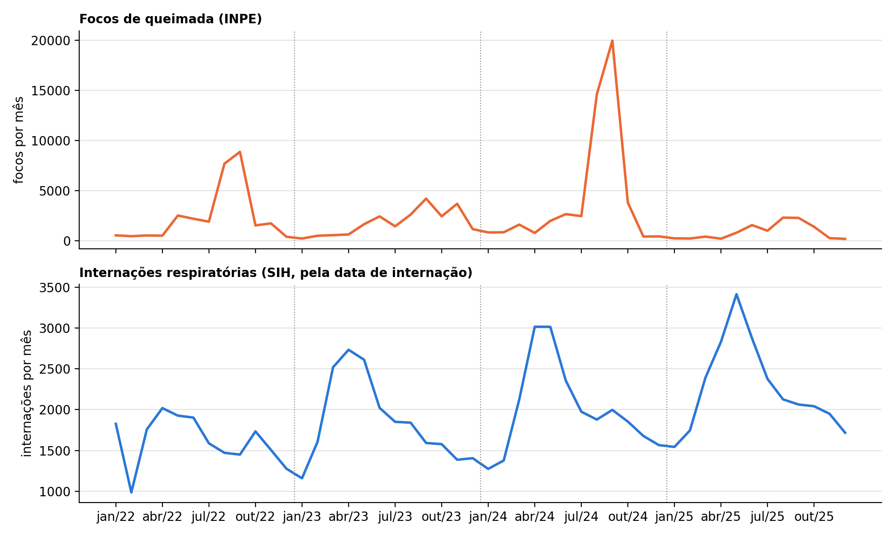

# Queimadas e internações respiratórias em Mato Grosso

Trabalho de conclusão de curso (TCC) que investiga se os focos de queimada ajudam a explicar ou prever as internações por doenças respiratórias nos municípios de Mato Grosso, de 2022 a 2025.

## Dados

Todos os dados são públicos e baixados automaticamente pelo notebook:

| Fonte | Conteúdo |
|---|---|
| [INPE – Programa Queimadas](https://terrabrasilis.dpi.inpe.br/queimadas/portal/) | focos de queimada anuais (satélite de referência) |
| [DATASUS – SIH/SUS](https://datasus.saude.gov.br/) | internações com diagnóstico respiratório (CID-10 capítulo J), via [PySUS](https://github.com/AlertaDengue/PySUS) |
| [IBGE – API de serviços de dados](https://servicodados.ibge.gov.br/api/docs) | municípios de MT e população do Censo 2022 |

## Método

1. Painel com uma linha por município e mês (142 municípios × 48 meses), com taxas de focos e de internação por 100 mil habitantes e os focos dos 2 meses anteriores.
2. Correlação de Pearson entre focos e internações, sem controle e com efeitos fixos de município e de período, com intervalo de confiança por bootstrap de municípios.
3. Agrupamento dos municípios com K-Means (PySpark MLlib).
4. Random Forest e GBT (PySpark MLlib) para prever a taxa de internação com e sem variáveis de focos, avaliados em três divisões treino/teste (aleatória, por município e por tempo) e comparados com linhas de base simples.

## Principais resultados

* As correlações entre focos e internações ficaram próximas de zero, e todos os intervalos de confiança incluem o zero.
* A diferença de R² entre modelos com e sem focos é pequena e de sinal variável, e negativa na validação por tempo (teste em 2025).
* Nenhum modelo superou a previsão simples "média do município + efeito do mês" (R² de 0,365 no teste em 2025, contra 0,085 do melhor modelo com focos).
* No período analisado, o perfil do município e a sazonalidade explicam as internações melhor que os focos de queimada.
* O K-Means isolou Cuiabá em um grupo próprio por causa da população muito maior que a dos demais municípios (limitação discutida no relatório).



## Como executar

Pré-requisitos (Windows):

* Python 3.10
* Java 11, Spark 3.5.4 e Hadoop (`winutils.exe`). Os caminhos ficam na célula de variáveis de ambiente do notebook. Ajuste-os para a sua máquina.

```bash
conda create -n tcc python=3.10
conda activate tcc
pip install -r requirements.txt
```

Depois, abra `tcc_queimadas_X_internacoes_MT.ipynb` e execute todas as células. Na primeira execução, os dados do INPE e do SIH são baixados para as pastas `dados_inpe/` e `dados_sih/`. Nas execuções seguintes, os arquivos já baixados são reaproveitados.

## Arquivos

| Arquivo | Conteúdo |
|---|---|
| `tcc_queimadas_X_internacoes_MT.ipynb` | notebook com todo o processo |
| `requirements.txt` | pacotes Python |
| `figuras_relatorio.py` | gera as figuras do relatório a partir dos arquivos de saída (precisa de uma pasta `fig/` e do pacote `pillow`) |
| `base_painel_multiano.csv` | painel município × mês com focos, internações, taxas e lags |
| `resumo_mensal_multiano.csv` | totais mensais do estado |
| `resultados_modelos_multiano.csv` | métricas (R², MAE, RMSE) de todos os modelos e linhas de base |
| `corr_efeitos_fixos_multiano.csv` | correlações e intervalos de confiança |
| `perfil_clusters_multiano.csv` | descrição dos clusters do K-Means |
| `perfil_municipios_multiano.csv` | perfil e cluster de cada município |
| `grafico1_serie_mensal_multiano.png`, `grafico2_modelo_multiano.png` | gráficos do trabalho |
